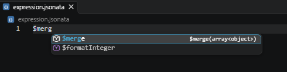
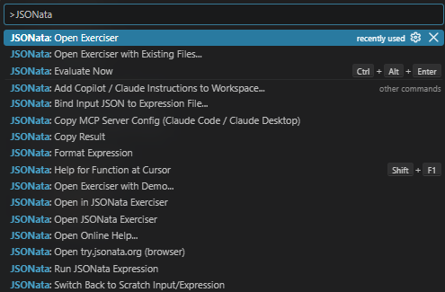

# JSONata Exerciser for VS Code

**Write, test and debug [JSONata](https://jsonata.org) expressions right next to your JSON, with live results, IntelliSense and AI help. Everything runs locally.**


* **100% local.** No API calls, no telemetry. Evaluation uses the official [`jsonata`](https://www.npmjs.com/package/jsonata) library, bundled into the extension.
* **Real time.** The result updates as you type.
* **Safe.** Evaluation runs in a worker thread with a timeout, so an endless recursion cannot freeze VS Code.

## What it can do

| | |
| --- | --- |
| **Live playground** | Three linked panes like the online [Exerciser](https://try.jsonata.org/): input JSON, expression, live result. Errors show in the result, the status bar and as squiggles in the expression. |
| **Works with your files** | Right-click any `.json` / `.jsonata` file and choose **Open in JSONata Exerciser**. The panes follow the files you open, and `.jsonata` files remember their input JSON. |
| **Real editor support** | Syntax highlighting, validation with exact error positions, completions for all `$functions` **and for the field names in your JSON**, signature help, hover docs, snippets. |
| **Formatter** | Format Document (`Shift+Alt+F`) for JSONata. Every result is verified to parse to the identical expression before it is applied. |
| **Demos** | Eight ready-made examples (paths, grouping, higher-order functions, regex and dates, recursion, and a broken expression to practice debugging). |
| **Online help** | Searchable doc pages and function reference, `Shift+F1` on any `$function`, hover links. |
| **GitHub Copilot** | `@jsonata` chat participant (`/write`, `/explain`, `/fix`) and agent-mode tools that read your data, evaluate expressions and verify their answers. |
| **Claude** | The same tools as an MCP server for Claude Code, Claude Desktop, Cursor and others. |
| **Project directives** | One command writes Copilot instruction files, a `/jsonata` prompt file and `CLAUDE.md` / `AGENTS.md` sections so every AI assistant in your repo knows how to handle JSONata. |

## Quick start

1. Open the Command Palette (`Ctrl+Shift+P`) and run **JSONata: Open Exerciser**, or **JSONata: Open Exerciser with Demo...** to start from an example.
2. Edit the JSON on the left or the expression on the right. The result updates immediately.
3. To use your own data: right-click a `.json` file in the Explorer and choose **Open in JSONata Exerciser**.

Your last scratch session is restored the next time you open the Exerciser.

## Working with your own files

* **Right-click** a `.json` file (Explorer, editor or tab) and choose **Open in JSONata Exerciser**: it becomes the input and the result shows on the right. Right-click a `.jsonata` file to use it as the expression.
* **Closed a pane?** Click the **Open JSONata Exerciser** button (JSONata image) in the title bar of a JSON or result editor, or the **Run JSONata Expression** play button in a `.jsonata` editor: it restores all three panes around that file. **JSONata: Evaluate Now** (`Ctrl+Alt+Enter`) does the same.
* **The panes follow what you open.** While the Exerciser is open, any JSON file you open (for example from the Explorer) is moved into the left pane and becomes the input; any `.jsonata` file is moved into the top-right pane and becomes the expression. Switch off with `jsonataExerciser.followEditors`. Your own files are never auto-saved; scratch documents never prompt for saving.
* **`.jsonata` files remember their input.** **JSONata: Bind Input JSON to Expression File...** (also in the context menu) links an expression to a JSON file, optionally as a header such as `/* input: ./samples/order.json */` that travels with the file in git.
* **Saving:** the scratch `expression.jsonata` / `input.json` panes exist only inside VS Code. Press `Ctrl+S` (or run **JSONata: Save Scratch Expression/Input to File...**) to save one as a real file; the Exerciser then continues with that file. Real files save normally.
* **JSONata: Switch Back to Scratch Input/Expression** returns to the temporary documents. **JSONata: Open Exerciser with Existing Files...** lets you pick both files from dialogs.

Any `*.jsonata` file also gets highlighting, validation, IntelliSense and formatting on its own.

Use the title-bar button to open the Exerciser from a JSON editor:


## Editor features

| Feature | Details |
| --- | --- |
| Live output | Re-evaluates on every edit (debounced); the status bar shows timing and errors. |
| Validation | Syntax errors come from the official parser with exact positions. Runtime errors (for example `T2002`) are underlined in the expression. Calls to unknown `$functions` get a warning. |
| IntelliSense | All built-in `$functions` with signatures and snippets, signature help while typing arguments, hover docs, keywords, variables you defined, and **field names from your input JSON** (path-aware: `Account.Order.` suggests the children of `Order`). |
| Formatter | Uses the [Stedi Prettier plugin](https://github.com/Stedi/prettier-plugin-jsonata) on top of the official parser. The output is re-parsed and must produce an identical AST, otherwise the text is left untouched and you get a message. |
| Snippets | `map`, `filter`, `reduce`, `sort`, `block`, `fn`, `groupby`, `reshape`, `regex`, ... |
| Online help | **JSONata: Open Online Help...** (searchable list of doc pages and every function), `Shift+F1` on a `$function`, hover link, **JSONata: Open try.jsonata.org (browser)**. Opens docs.jsonata.org in your browser; the extension itself never makes network calls. |

IntelliSense suggests field names from the input JSON as you build a path:


Built-in function completions include their signatures:



## GitHub Copilot

Requires GitHub Copilot Chat. Works with whichever model you select, including Claude models offered through Copilot.

* **`@jsonata` chat participant** with `/write`, `/explain` and `/fix`. It sees your data and expression, answers with a `jsonata` code block, then **verifies the proposed expression locally** against your input and offers an **Apply to Exerciser** button.
* **Agent mode tools** (reference them as `#jsonataEvaluate`, `#jsonataValidate`, `#jsonataInputStructure`, `#jsonataGuide`, `#jsonataExerciserState`, `#jsonataExerciserUpdate`, or let the model pick): evaluate and validate expressions against real data, read your Exerciser (expression, input, result, error), get a compact outline of a JSON file, and, after confirmation, update the Exerciser.

For example, ask for product names prefixed with their order IDs as keys and prices as values. Copilot can read the Exerciser input and verify the expression against it:


### Giving Copilot the right context

Copilot only knows what you show it. Pick whichever works best:

| You write in chat | What happens |
| --- | --- |
| `@jsonata /write #file:orders.json total per customer` | The participant reads the attached file, adds a **structure outline** (key names, nesting, arrays) plus a JSONata cheat sheet to the prompt, answers, then **tests the expression locally** and offers *Apply to Exerciser*. |
| `@jsonata /fix` | Uses the expression, input and error currently in your Exerciser. |
| `@jsonata` plus a ```` ```json ```` and/or ```` ```jsonata ```` block in the message | Those blocks are used as input/expression instead of the Exerciser content. |
| Agent mode: `Use #jsonataExerciserState and write an expression that ...` | The model reads your Exerciser, writes an expression and evaluates it with `#jsonataEvaluate` until it works. |
| Agent mode with files: `Using #jsonataInputStructure on data/orders.json ...` | Large files are never pasted: the tools take `inputFile` / `expressionFile` paths. |
| `#jsonataGuide` | Loads the cheat sheet, function list and workflow if the model keeps writing JavaScript-style expressions. |

**Make it permanent for a repository:** run **JSONata: Add Copilot / Claude Instructions to Workspace...**. It creates

* `.github/instructions/jsonata.instructions.md` (applies to `*.jsonata`: cheat sheet plus the workflow "read the data, write, *evaluate*, then answer"),
* `.github/prompts/jsonata.prompt.md` (type `/jsonata` in Copilot Chat; asks for your goal and runs the full tool workflow),
* a `CLAUDE.md` (and optionally `AGENTS.md`) section for Claude Code and other agents.

Review and commit these files. They are plain Markdown you can adapt to your project.

AI answers can be wrong. The local check catches syntax errors and shows the real output, but you remain responsible for confirming the logic is what you intended.

## Claude

Any Claude surface that supports MCP can use the same tools through the bundled stdio MCP server (`dist/mcp-server.js`, built with the official MCP SDK). Tools: `jsonata_evaluate`, `jsonata_validate`, `jsonata_format`, `jsonata_function_help`, `jsonata_describe_input`, `jsonata_guide`.

1. Run **JSONata: Copy MCP Server Config (Claude Code / Claude Desktop)** to copy ready-made snippets with the correct absolute path.
2. **Claude Code** (CLI or VS Code extension): paste `claude mcp add jsonata -- node "<path>/mcp-server.js"` in a terminal, or put the `mcpServers` JSON into a project `.mcp.json`.
3. **Claude Desktop / Cursor / others:** merge the JSON snippet into their MCP configuration.

The extension folder name contains the version number, so after an update re-run the copy command (or copy `mcp-server.js` and `worker.js` together to a fixed folder and point the config there). Node.js 20+ must be on `PATH`.

VS Code users can alternatively enable `jsonataExerciser.ai.registerMcpServerInVsCode` to list the server in VS Code's MCP tools. It is off by default because Copilot already gets the native tools.

## Commands and shortcuts

Open the Command Palette (`Ctrl+Shift+P`) and type `JSONata` to find the extension's commands:



| Command (Command Palette: "JSONata: ...") | Shortcut / where |
| --- | --- |
| Open Exerciser | Status bar item, title-bar icon |
| Open Exerciser with Demo... | Title bar of `.jsonata` files |
| Open in JSONata Exerciser | Right-click `.json`, `.jsonc`, `.jsonata` files and editor tabs |
| Open Exerciser with Existing Files... | |
| Bind Input JSON to Expression File... | Right-click a `.jsonata` file |
| Switch Back to Scratch Input/Expression | |
| Evaluate Now | `Ctrl+Alt+Enter` (`Cmd+Alt+Enter` on macOS) |
| Format Expression | `Shift+Alt+F` (Format Document) |
| Copy Result | |
| Open Online Help... | Title bar of `.jsonata` files |
| Help for Function at Cursor | `Shift+F1` |
| Open try.jsonata.org (browser) | |
| Copy MCP Server Config (Claude Code / Claude Desktop) | |
| Add Copilot / Claude Instructions to Workspace... | |

## Settings

| Setting | Default | Meaning |
| --- | --- | --- |
| `jsonataExerciser.followEditors` | `true` | JSON / `.jsonata` files you open move into the input / expression pane |
| `jsonataExerciser.autoEvaluate` | `true` | Evaluate while typing |
| `jsonataExerciser.debounceMs` | `150` | Delay after the last keystroke |
| `jsonataExerciser.evaluationTimeoutMs` | `5000` | Abort long-running evaluations |
| `jsonataExerciser.format.printWidth` | `80` | Formatter line width |
| `jsonataExerciser.intellisense.fieldSuggestions` | `true` | Suggest field names from the input JSON |
| `jsonataExerciser.ai.registerMcpServerInVsCode` | `false` | Also register the MCP server in VS Code |

## Known limitations

* The formatter is the community Prettier plugin. It has at least one printer bug (a predicate after an object constructor, for example `a.{"x":y}[x>1]`, is dropped). The AST check blocks such output, so the formatter refuses instead of corrupting your expression.
* JSONata *bindings* (`jsonata.evaluate(input, bindings)`) are not exposed in the UI, so a `$function` supplied by a host application shows an "unknown function" warning here.
* The Exerciser targets the JSONata version bundled in the extension (2.x). Behavior of your production runtime may differ if it uses another version or a different implementation (for example a non-JavaScript port).
* Large inputs (several MB) are re-parsed on every keystroke; raise `debounceMs` if typing lags.

## Development

```bash
npm install
npm run build        # bundles extension, worker and MCP server into dist/
npm test             # builds, then runs unit tests (evaluator, demos, formatter, IntelliSense and AI helpers)
npm run typecheck
```

Press `F5` in VS Code to launch an Extension Development Host. The `src/core` folder has no dependency on `vscode`, so it is covered by plain Node tests. See [PUBLISHING.md](PUBLISHING.md) for how to release.

## Third-party software

Bundled (all MIT): `jsonata`, `prettier`, `@stedi/prettier-plugin-jsonata`, `@modelcontextprotocol/sdk`, `zod`. JSONata is an independent open-source project; this extension is not affiliated with or endorsed by the JSONata project.

## License

MIT, see [LICENSE](LICENSE).
