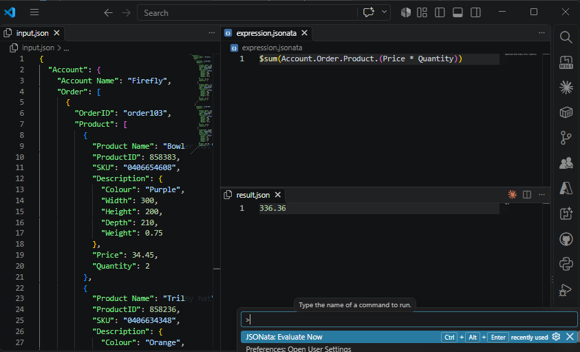
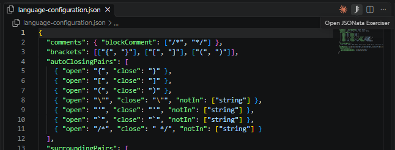
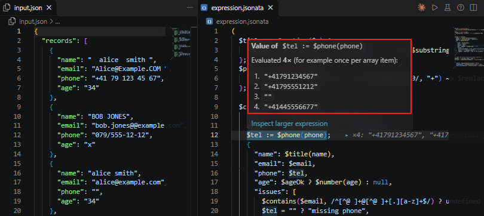
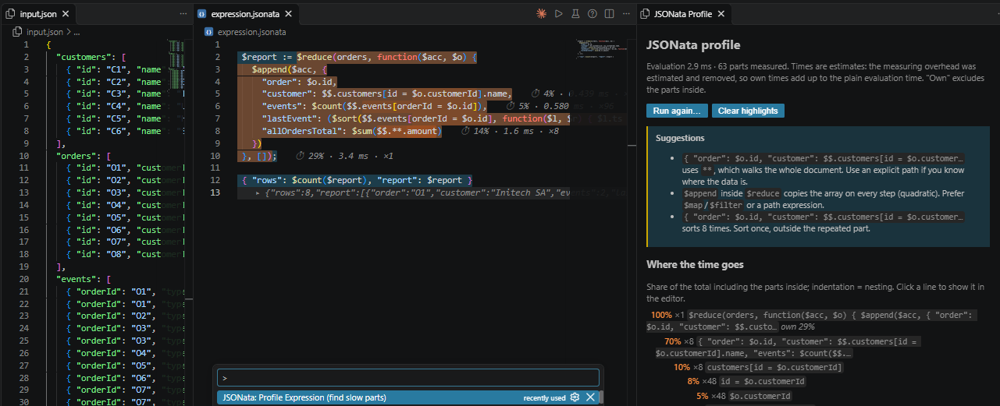
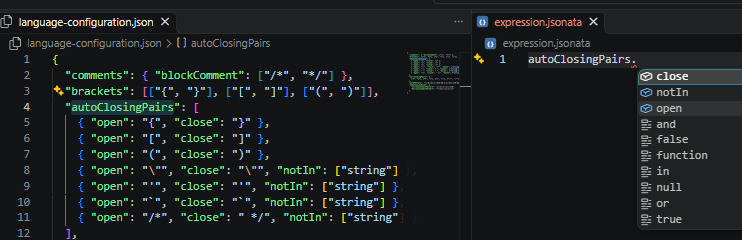
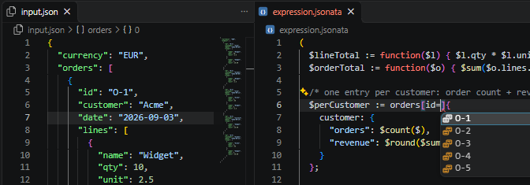
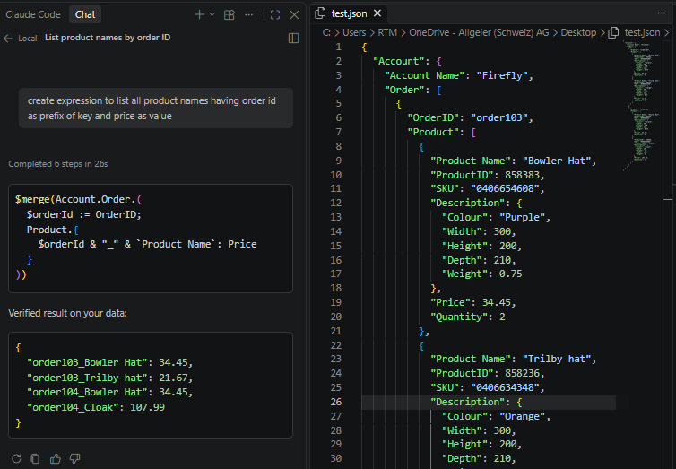

<div align="center">

# JSONata Exerciser for VS Code

**Write, test, debug and profile [JSONata](https://jsonata.org) expressions right next to your JSON.**<br>
Live results, step-through inspection, a performance profiler, IntelliSense, a formatter and AI help for GitHub Copilot and Claude.<br>
**100% local. No API calls. No telemetry.**

[](https://marketplace.visualstudio.com/items?itemName=ro-rtm.jsonata-exerciser)
[](LICENSE)




</div>

## Why you will like it

| | |
| --- | --- |
| **Live as you type** | Three linked panes like [try.jsonata.org](https://try.jsonata.org/): input, expression, result. Updates on every keystroke. |
| **See inside an expression** | Put the cursor on any part and see what it evaluates to, per item and step by step. |
| **Click your way around** | Right-click a field in the input JSON to insert its JSONata path. Click a value in the result and the part of the expression that produced it lights up. |
| **Find the slow part** | Heat map, ranked report and concrete fixes for slow expressions, optionally on simulated larger data. |
| **Works with your project** | Right-click any JSON or `.jsonata` file. Expressions remember their input file. |
| **AI that checks its work** | Copilot and Claude read your data, write an expression, run it locally and fix it until it works. |
| **Safe and private** | Official `jsonata` library bundled in the extension, run in a worker thread with a timeout. Nothing leaves your machine. |

## Everything it can do

### Exerciser

* Three-pane live playground: input JSON (left), expression (top right), result (bottom right).
* Errors appear in the result, the status bar and as squiggles in the expression.
* Panes **follow the files you open**: a JSON file becomes the input, a `.jsonata` file becomes the expression (setting `followEditors`).
* Click a result value to see which part of the expression produced it; right-click an input field to insert its path.
* **Open JSONata Exerciser** button in the title bar of JSON editors, **Run** play button and **Profile** gauge in `.jsonata` editors.
* Closed a pane? The buttons and **Evaluate Now** (`Ctrl+Alt+Enter`) restore all three.
* Scratch documents survive a restart and can be saved as real files with `Ctrl+S`.
* `.jsonata` files can be bound to an input file, stored as a header such as `/* input: ./samples/order.json */` that travels with the file in git.
* **13 demos**, from "Hello" to sales ranking, joins, recursive tree walking, event-log statistics, data cleansing and a broken expression to practice debugging.



### Step-through inspection

Debug an expression like code. Move the cursor or select a part and see its value for your current input.

```
$sum(orders.items.(price * qty))
                    ^ cursor on "price"         ▸ ×3: 2, 4, 5
```



* Inline hint and hover with the full value; parts inside paths or `$map` show one value per item (`×3: 2, 4, 5`).
* Paths list every step (`orders`, `orders.items`, `orders.items.price`) with count and value, so you see exactly where matching stops.
* Parts that are never reached say so instead of showing an empty value.
* **Inspect Larger Expression** (`Ctrl+Alt+Shift+J`) widens the selection: `price` → `price * qty` → `orders.items.(price * qty)` → everything.
* Keys: **Inspect Value** `Ctrl+Alt+J`; toggle live hints with `inspect.live`.

### Navigate between data and expression

* **Input to expression:** right-click a value or key in the input JSON and choose **Insert JSONata Path into Expression** (or **Copy JSONata Path of Value at Cursor**). Array indexes are dropped because JSONata maps over arrays (`orders.items.price`); names with spaces or symbols get backticks (`` orders.`my key` ``). Setting `navigate.arrayIndexes` = `include` keeps them (`orders[1].items[0].price`).
* **Result to expression:** click a value or key in the result pane. The part of the expression that produced it is highlighted and scrolled into view, with a hint such as `◂ produces summary.total`. If several parts yield the same value, run **Reveal Expression Part for Result Value** (`Ctrl+Alt+R`) again to step through the candidates. Switch the click behavior off with `navigate.live`.
* Matching uses the same probes as step-through inspection, so it works for any expression. A value assembled from several parts (for example a string concatenation) has no single source and reports that.

### Performance profiler

Click the **gauge icon** in a `.jsonata` editor, or run **JSONata: Profile Expression**.



* Choose current data or **Arrays x10 / x100 / x1000** to simulate bigger input.
* **Heat map** in the editor with inline hints such as `⏱ 99% · 6979 ms · ×1500`.
* **Report** with a time tree, hot-spot table (own time, calls, µs per call); click a line to jump to the part.
* **Suggestions** for typical problems: filter inside a loop (use `$lookup` on an index), `$append` in `$reduce`, `**` on large documents, sort in a loop, `$eval` in a loop.

### Editor support

| Feature | Details |
| --- | --- |
| Validation | Errors from the official parser with exact positions; runtime errors (for example `T2002`) underlined; warning for unknown `$functions`. |
| IntelliSense | All `$functions` with signatures, signature help, hover docs, keywords, your variables, and **field names from your input JSON** (path-aware) and **filter values**: type `orders[status='` and get the values that occur in the input, most frequent first. |
| Formatter | `Shift+Alt+F`. Prettier plus the [Stedi plugin](https://github.com/Stedi/prettier-plugin-jsonata); output must parse to an identical AST or it is not applied. Choose object layout: `preserve`, `expanded` or `auto`. |
| Snippets | `map`, `filter`, `reduce`, `sort`, `block`, `fn`, `groupby`, `reshape`, `regex`, ... |
| Online help | Searchable docs and function reference, `Shift+F1` on a `$function`, hover links, **Open try.jsonata.org**. Only opens your browser on request. |



Filter values come from the input too. Typing `orders[id=` lists the `id` values that occur in the data:



### AI: GitHub Copilot and Claude

| | |
| --- | --- |
| **`@jsonata` chat participant** | `/write`, `/explain`, `/fix`. Sees your data and expression, answers with a `jsonata` block, verifies it locally and offers **Apply to Exerciser**. |
| **Agent-mode tools** | `#jsonataEvaluate`, `#jsonataValidate`, `#jsonataInspect`, `#jsonataProfile`, `#jsonataInputStructure`, `#jsonataGuide`, `#jsonataExerciserState`, `#jsonataExerciserUpdate`. |
| **Claude via MCP** | Bundled stdio server for Claude Code, Claude Desktop, Cursor and others: evaluate, inspect, profile, validate, format, function help, describe input, guide. |
| **Project directives** | One command writes Copilot instruction files, a `/jsonata` prompt file and `CLAUDE.md` / `AGENTS.md` sections. |



## Quick start

1. Install the extension.
2. Press `Ctrl+Shift+P` and run **JSONata: Open Exerciser**, or **JSONata: Open Exerciser with Demo...**.
3. Edit the JSON or the expression. The result updates immediately.
4. For your own data: right-click a `.json` file and choose **Open in JSONata Exerciser**.

## Working with your own files

* **Right-click** a `.json` / `.jsonc` file (Explorer, editor, tab) and choose **Open in JSONata Exerciser**. Right-click a `.jsonata` file to use it as the expression.
* **Bind input:** **JSONata: Bind Input JSON to Expression File...** links an expression to a JSON file.
* **Save scratch:** `Ctrl+S` on `expression.jsonata` / `input.json` saves a real file and the Exerciser continues with it. Your own files are never auto-saved.
* **Switch Back to Scratch** returns to the temporary documents; **Open Exerciser with Existing Files...** picks both files from dialogs.

## GitHub Copilot

Requires GitHub Copilot Chat. Works with the model you select, including Claude models offered through Copilot.

| You write in chat | What happens |
| --- | --- |
| `@jsonata /write #file:orders.json total per customer` | Reads the file, adds a structure outline and cheat sheet, answers, **tests the expression locally**, offers *Apply to Exerciser*. |
| `@jsonata /fix` | Uses the expression, input and error currently in your Exerciser. |
| `@jsonata` plus a ```` ```json ```` / ```` ```jsonata ```` block | Uses those blocks instead of the Exerciser content. |
| Agent mode: `Use #jsonataExerciserState and write an expression that ...` | Reads your Exerciser, writes, and evaluates with `#jsonataEvaluate` until it works. |
| Agent mode: `Using #jsonataInputStructure on data/orders.json ...` | Large files are never pasted; tools take `inputFile` / `expressionFile` paths. |
| `#jsonataGuide` | Loads cheat sheet and workflow if the model writes JavaScript-style expressions. |

**Make it permanent for a repository:** run **JSONata: Add Copilot / Claude Instructions to Workspace...**. It creates `.github/instructions/jsonata.instructions.md`, `.github/prompts/jsonata.prompt.md` (type `/jsonata`), and a `CLAUDE.md` (optionally `AGENTS.md`) section. Review and commit them; they are plain Markdown.

AI answers can be wrong. The local check catches syntax errors and shows real output, but you must confirm the logic is what you intended.

## Claude (MCP)

Tools: `jsonata_evaluate`, `jsonata_inspect`, `jsonata_profile`, `jsonata_validate`, `jsonata_format`, `jsonata_function_help`, `jsonata_describe_input`, `jsonata_guide`.

1. Run **JSONata: Copy MCP Server Config (Claude Code / Claude Desktop)** for snippets with the correct absolute path.
2. **Claude Code:** `claude mcp add jsonata -- node "<path>/mcp-server.js"`, or put the `mcpServers` JSON into a project `.mcp.json`.
3. **Claude Desktop / Cursor / others:** merge the JSON snippet into their MCP configuration.

The extension folder name contains the version, so re-run the copy command after an update (or copy `mcp-server.js` and `worker.js` to a fixed folder). Node.js 20+ must be on `PATH`. Optionally enable `jsonataExerciser.ai.registerMcpServerInVsCode` to list the server in VS Code.

## Commands and shortcuts

Type `JSONata` in the Command Palette (`Ctrl+Shift+P`).

| Command | Shortcut / where |
| --- | --- |
| Open Exerciser | Status bar, title-bar icon |
| Open Exerciser with Demo... | Title bar of `.jsonata` files |
| Open in JSONata Exerciser | Right-click `.json`, `.jsonc`, `.jsonata`, editor tabs |
| Open Exerciser with Existing Files... | |
| Bind Input JSON to Expression File... | Right-click a `.jsonata` file |
| Switch Back to Scratch Input/Expression | |
| Evaluate Now | `Ctrl+Alt+Enter` (`Cmd+Alt+Enter` on macOS) |
| Inspect Value at Cursor / Selection | `Ctrl+Alt+J`, editor context menu |
| Inspect Larger Expression | `Ctrl+Alt+Shift+J` |
| Toggle Live Value Inspection | |
| Insert JSONata Path into Expression | Right-click a value in a JSON editor |
| Copy JSONata Path of Value at Cursor | Right-click a value in a JSON editor |
| Reveal Expression Part for Result Value | `Ctrl+Alt+R` in the result pane, right-click, or just click a value |
| Profile Expression (find slow parts) | Gauge icon in `.jsonata` editors, context menu |
| Clear Profile Highlights | |
| Format Expression | `Shift+Alt+F` |
| Copy Result | |
| Open Online Help... | Title bar of `.jsonata` files |
| Help for Function at Cursor | `Shift+F1` |
| Open try.jsonata.org (browser) | |
| Copy MCP Server Config | |
| Add Copilot / Claude Instructions to Workspace... | |

## Settings

| Setting | Default | Meaning |
| --- | --- | --- |
| `jsonataExerciser.followEditors` | `true` | Opened JSON / `.jsonata` files move into the input / expression pane |
| `jsonataExerciser.autoEvaluate` | `true` | Evaluate while typing |
| `jsonataExerciser.debounceMs` | `150` | Delay after the last keystroke |
| `jsonataExerciser.evaluationTimeoutMs` | `5000` | Abort long-running evaluations |
| `jsonataExerciser.inspect.live` | `true` | Inline value of the part under the cursor |
| `jsonataExerciser.inspect.maxLength` | `80` | Maximum length of the inline hint |
| `jsonataExerciser.navigate.live` | `true` | Clicking a result value highlights the part of the expression that produced it |
| `jsonataExerciser.navigate.arrayIndexes` | `omit` | Inserted/copied input paths: `omit` drops array indexes, `include` keeps them |
| `jsonataExerciser.profile.timeoutMs` | `120000` | Abort profiling after this many ms |
| `jsonataExerciser.format.printWidth` | `80` | Formatter line width |
| `jsonataExerciser.format.objectLayout` | `preserve` | `preserve` keeps multi-line objects if you broke after `{`, `expanded` breaks every key, `auto` collapses what fits |
| `jsonataExerciser.intellisense.fieldSuggestions` | `true` | Suggest field names from the input JSON |
| `jsonataExerciser.intellisense.valueSuggestions` | `true` | Suggest the values found in the input when typing a filter such as `orders[status='` |
| `jsonataExerciser.ai.registerMcpServerInVsCode` | `false` | Also register the MCP server in VS Code |

## How it works

* **Evaluation:** the official `jsonata` library in a worker thread with timeout; a newer edit supersedes a running evaluation.
* **Inspection:** the inspected part `x` is temporarily replaced by `$__probe(x)`, which records values and returns them unchanged, so the rest behaves as before.
* **Profiling:** the expression is rewritten once so every part reports start and end; measuring overhead is estimated, removed, and own times are scaled to the plain run. Use the numbers to compare parts, not as exact values.

## Known limitations

* The formatter is a community plugin with at least one printer bug (a predicate after an object constructor, for example `a.{"x":y}[x>1]`, is dropped). The AST check blocks such output, so the formatter refuses instead of corrupting your expression.
* JSONata *bindings* supplied by a host application are not exposed, so such `$functions` show an "unknown function" warning.
* The Exerciser targets the bundled JSONata 2.x. Your production runtime may behave differently (another version or a non-JavaScript port).
* Large inputs (several MB) are re-parsed on every keystroke; raise `debounceMs` if typing lags.
* **After updating the extension, reload the window** (use the *Reload Window* / *Restart Extensions* prompt, or `Developer: Reload Window`). A running window can keep pointing at files of the old version, so the Exerciser, the demo picker or the evaluator may not start until you reload. The extension shows a *Reload Window* prompt when it detects this. If the three panes were open during the update, reload once and use **JSONata: Open Exerciser** if they do not resume on their own.

## Development

```bash
npm install
npm run build        # bundles extension, worker and MCP server into dist/
npm test             # builds, then runs unit tests
npm run typecheck
```

Press `F5` for an Extension Development Host. `src/core` has no `vscode` dependency and is covered by plain Node tests. See [PUBLISHING.md](PUBLISHING.md) to release and [CHANGELOG.md](CHANGELOG.md) for history.

## Third-party software

Bundled (all MIT): `jsonata`, `prettier`, `@stedi/prettier-plugin-jsonata`, `@modelcontextprotocol/sdk`, `zod`. JSONata is an independent open-source project; this extension is not affiliated with or endorsed by it.

## License

MIT, see [LICENSE](LICENSE).
